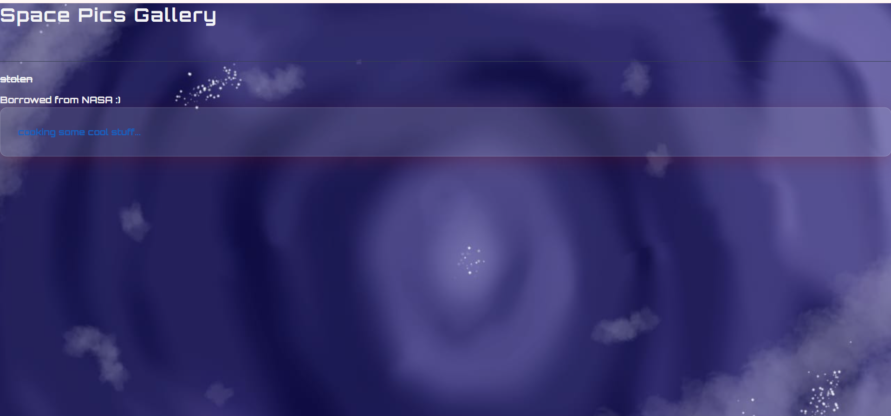
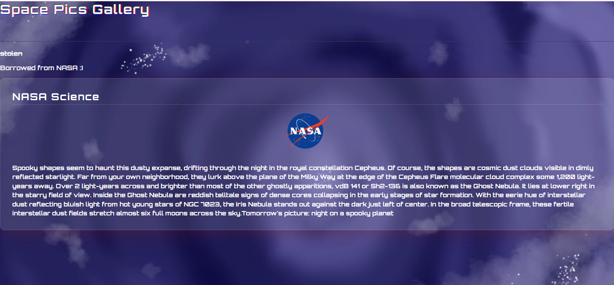

# Luna's Lobby [Important note: 'Give Your Website a Pulse' mission move to line 42]
An interactive, space themed website dedicated to explore fascinating facts about the universe.
 
 

 ### Try The Website: 
 **[Quick start: Click here to open the demo](https://lunalight-coder.github.io/luna-labsfinal)**

 ### Core-features: 
 The website has 5 sections-
 2-Novel
 3-Factopia
 4-MiniCafe  
 5-About Me

 ### I NASA APOD:
 This page uses NASA API to fetch APOD and displays it with custom styling.
 
 ### II-Novel: 
 This is a section for my weekly novel . It is an interactive webpage with a realistic page-flipping animation and an index for easier navigation.
 * Smart-Tracking: When you first open the website , it will show you the latest page (end page) instead of the first page to keep the reader updated . In this case, it displays "Coming Soon" where content will soon be updated.
 * AI Transparency: I used AI in this section comparatively more as this section was hard to code including complex functions. But still, I made sure to understand the code and did my own custom changes to the code.
 

 ### III-Factopia:
  An interactive section with a flashcard animation. The front side shows a hook question, and the answer on the back will be revealed upon clicking.

 ### IV-MiniCafe:
   This section is interactive and moves up when mouse hovers over it and contains information about chemical elements found in space that are also commonly found in food recipes.

 ### V-About Me: 
 This section is short, containing brief information about me, keeping in mind the personal website theme . This section is non-interactive.

 ### *Additional Information*:
 *Glitter Trail: The mouse cursor on this website has a glitter trail effect to enhance the experience.
 *Title: The welcome title has a glitching effect when mouse hovers over the text.

 

 ### What Updates I did for 'Give Your Website a Pulse' mission:

 ### Try DEMO:
 **[Quick start: Click here to open the demo](https://lunalight-coder.github.io/luna-labsfinal/nasa.html)**

 

 
 *API: As per the requirements I added a separate page for NASA APOD which fetches APOD (TEXT-ONLY) using API, stored by vite. I added my custom styling and animations.
 *Animations:-
     -Glitter Trail: The mouse cursor on this webpage has a glitter trail effect to enhance the experience similar to the homepage.
     -Title: The welcome title has a glitching effect when mouse hovers over the text just like the homepage.
     -APOD box- The APOD box moves upwards when mouse hovers over the box

 [AI disclosure: I used AI ONLY for debugging, rest styling and everything is done by me]
